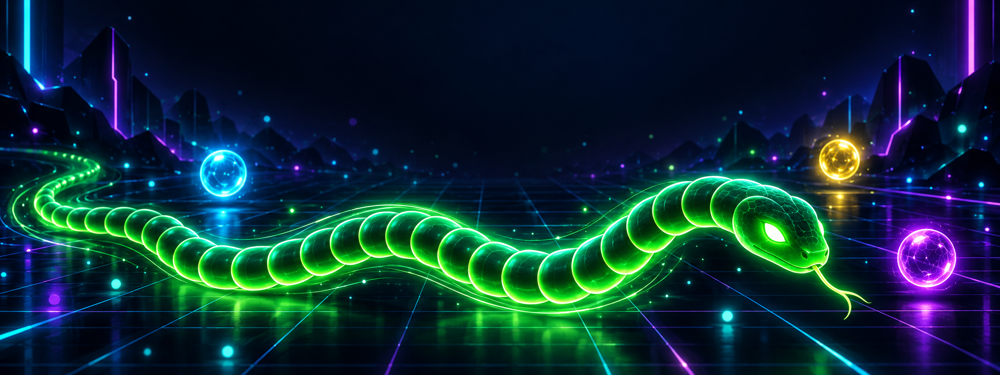

<div align="center">



# 🐍 SNAKE NEON

### EAT ✦ GROW ✦ BEAT YOUR BEST

**A premium cyber-neon arcade Snake game for the browser.**
Real engine. Real physics. Real polish. Zero dependencies-at-runtime, one self-contained HTML file.


[Quick Start](#-quick-start) · [Gameplay](#-gameplay) · [Controls](#-controls) · [Mechanics](#-mechanics-deep-dive) · [Architecture](#-architecture) · [Tuning](#-tuning) · [Deployment](#-deployment)

</div>

---

## ✦ Overview

SNAKE NEON is a modern re-imagining of the classic Snake, built to the standard of a premium arcade title — not a coding demo. It pairs a **deterministic fixed-timestep simulation** (grid-fair collisions, identical at 30/60/144 FPS) with **butter-smooth interpolated rendering**, layered neon glow, pooled particles, screen shake, synthesized audio, power-ups, combos, and a persistent local leaderboard.

A live **attract mode** plays the game by itself behind the main menu — an autopilot snake hunts orbs and occasionally crashes in style.

## ✦ Feature Highlights

| Category | Details |
|---|---|
| 🎮 Gameplay | Classic snake loop with combo multipliers, score-ramped speed, 4 orb types, 4 power-ups, level milestones |
| 🖥 Engine | Fixed-timestep sim + accumulator, render interpolation, frame-rate independent, spiral-of-death guard |
| 💥 Juice | Trauma-based screen shake, additive particle pool (capped 420), eat pulse rings, glow trail, floating `+N` popups, death shatter, level-up flash |
| 🔊 Audio | 100% synthesized WebAudio SFX (no assets) — eat pitch rises with combo, countdown, death sweep, fanfare — plus an optional ambient synth pad |
| 📱 Mobile | Swipe steering (pointer-based), optional 54px virtual D-pad, safe-area aware, touch-scroll locked |
| 🧩 UI/UX | Glassmorphism neon panels, Orbitron/Chakra Petch type, animated countdown 3-2-1-GO, pause & game-over overlays, power-up countdown rings |
| 💾 Persistence | High score, best length, best combo, Top-5 leaderboard and all settings in `localStorage` (corruption-safe) |
| ♿ A11y | Keyboard-focusable buttons, visible focus rings, aria-live announcements, reduced-motion mode (auto-detects OS setting) |
| 🤖 Demo | Autopilot attract mode with safe-direction heuristics on the menu screen |

## ✦ Quick Start

```bash
# 1. install
npm install

# 2. dev server (hot reload)
npm run dev          # → http://localhost:5173

# 3. production build (single self-contained HTML)
npm run build        # → dist/index.html  (~340 kB, everything inlined)

# 4. preview the production build
npm run preview      # → http://localhost:4173
```

Requires **Node 18+**. No environment variables, no API keys, no backend.

## ✦ Controls

| Input | Action |
|---|---|
| `↑ ↓ ← →` / `W A S D` | Steer the snake (buffered, no 180° reversal) |
| `Space` / `Enter` | Start · Pause · Resume · Quick-restart |
| `Esc` | Pause / resume, close panels |
| `R` | Instant restart (game over / pause) |
| **Swipe** (touch or mouse-drag) | Steer on touch devices |
| **D-pad** (on-screen) | Optional virtual pad, large 54px targets |

Arrow keys and space never scroll the page; the game ignores input while menus/modals are open but keeps native button activation for accessibility.

## ✦ Gameplay

**Objective:** eat energy orbs → grow → score → speed rises → survive → beat your best.

```
MOVE → FIND ORB → EAT → GROW → SCORE → SPEED UP → SURVIVE → NEW HIGH SCORE
```

💥 **Game over** when the head hits a wall or the body (unless a Shield is active — it absorbs one hit and auto-steers to safety).

### Game states

```
MENU ──▶ READY (3 · 2 · 1 · GO!) ──▶ PLAYING ⇄ PAUSED ──▶ GAME OVER ──▶ (again)
 ▲          attract-mode demo            auto-pause on tab blur/hide      │
 └─────────────────────────── MAIN MENU ◀─────────────────────────────────┘
```

## ✦ Mechanics Deep-Dive

### Orbs

| Orb | Points | Growth | Notes |
|---|---|---|---|
| 🔵 Normal | +10 | +1 | always exactly one on the board |
| 🟡 Gold | +25 | +2 | unlocks at score ≥ 90, lives 12 s |
| 🟣 Purple bonus | +50 | +3 | unlocks at score ≥ 180, lives 7 s, blinks before expiring |
| 💗 Energy | +15 | +1 | unlocks at score ≥ 140, grants a random power-up, lives 9 s |

Spawning is grid-aware: never on the snake, never on another orb, minimum Manhattan distance 4 from the head, and specials spawn by per-simulation-step probability (frame-rate independent). Expired orbs respawn naturally.

### Combo multiplier

Eat again within **6 seconds** to chain the combo (draining bar in the HUD):

| Chain | ×1 | ×2 | ×3 | ×4 | ×5+ |
|---|---|---|---|---|---|
| Multiplier | 1.0 | 1.2 | 1.5 | 1.7 | 2.0 |

Stacks with Double Score (×2), Overdrive (×1.5) and Hard difficulty (×1.25).

### Power-ups (via energy orbs)

| Power | Duration | Effect |
|---|---|---|
| ⚡ Overdrive | 4 s | +38% speed, ×1.5 score — risk/reward frenzy |
| 🕒 Slow-Mo | 3 s | time dilates to 55% — threading the needle |
| 🛡 Shield | until hit | absorbs one wall/self collision and steers to safety |
| ✦ Double Score | 5 s | all points ×2 |

Only one field-instance of each special can exist; re-collecting refreshes the timer. HUD badges show live countdown rings (real-time, pause-safe).

### Difficulty curve

Speed is a smooth function of score — never stepwise, never unfair:

```
speed = min(maxSpeed, base + score × 0.021)   [cells/second]
        normal: base 8.5 → max 20
        hard:   base 10  → max 24 (+25% score bonus)
Level = 1 + floor(score / 100)   → level-up flash, fanfare, burst
```

The board grid adapts to the viewport (20–34 × 14–24 cells), so the challenge stays proportionate on phones and ultrawides.

## ✦ Architecture

Clean module separation — the engine is pure TypeScript DOM-free logic; React owns only chrome/menus/HUD.

```
src/
├── game/                  # ← the engine (zero React imports)
│   ├── config.ts          #    all tuning constants (speeds, scores, colors, TTLs)
│   ├── types.ts           #    shared types (Direction, Phase, UiState, …)
│   ├── utils.ts           #    math, easing, color helpers
│   ├── engine.ts          #    GameEngine: states, fixed-timestep loop, scoring,
│   │                      #    combos, power-ups, autopilot, shake, UI snapshots
│   ├── snake.ts           #    grid logic + prev-frame copies for interpolation
│   ├── food.ts            #    orb lifecycle, rarity rolls, spawn safety
│   ├── renderer.ts        #    Canvas2D: grid, layered-glow snake, orbs, icons,
│   │                      #    popups, DPR-aware, shake transform
│   ├── particles.ts       #    fixed-capacity pool, swap-remove, additive blend
│   ├── audio.ts           #    WebAudio synth SFX + ambient pad (gesture-unlocked)
│   ├── input.ts           #    keyboard (e.code) + pointer swipes
│   └── storage.ts         #    corruption-safe localStorage + Top-5 recorder
├── components/            # ← React chrome (menus, HUD, panels, D-pad)
│   ├── GameShell.tsx      #    engine ↔ React bridge (snapshots → state)
│   ├── MainMenu.tsx  Hud.tsx  Overlays.tsx  Panels.tsx
│   ├── Dpad.tsx  BackgroundFx.tsx  ui-kit.tsx
│   └── utils/cn.ts        #    clsx + tailwind-merge
└── App.tsx / main.tsx / index.css
```

### The loop (why it feels good)

```
rAF:  dt = clamp(frame delta, ≤ 55 ms)
      acc += dt
      while acc ≥ step:  simulate one grid step   # logic is ALWAYS grid-exact
      alpha = acc / step
      render(lerp(prevCells, cells, alpha))        # visuals glide at full FPS
```

Collisions are decided only on the logical step — interpolation can never eat you. UI stays 60 FPS on 30 Hz devices and on 144 Hz displays alike, and tab-switch auto-pauses so background throttling never kills a run.

### Rendering layers (single canvas)

board gradient → neon grid → ambient dust → border glow + travelling spark → orbs (halo, orbits, rings, icons) → snake trail → 3-pass glow polyline + gradient body + directional eyes + eat ring → particles (additive) → score popups → level flash / power tint → attract watermark. Chrome (HUD, menus) is ordinary DOM for crisp text and a11y.

### Persistence schema (`localStorage["snake-neon-v1"]`)

```jsonc
{
  "best": 1240, "bestLength": 48, "bestCombo": 7,
  "board": [{ "score": 1240, "length": 48, "combo": 7, "date": 1739999999999 }],
  "settings": {
    "sound": true, "music": false, "shake": true, "particles": true,
    "reducedMotion": false, "difficulty": "normal", "dpad": true
  }
}
```

Loads are schema-validated and fault-tolerant; corrupted or unavailable storage degrades to in-memory defaults.

## ✦ Tech Stack

- **React 19** + **TypeScript** (strict, `noUnusedLocals`) + **Vite 7**
- **Tailwind CSS 4** (`@theme` design tokens) + **lucide-react** icons
- **Canvas 2D** renderer, **WebAudio** synth, **vite-plugin-singlefile** output
- Zero images/fonts at runtime beyond Google Fonts — all game art is procedural

## ✦ Performance

Pooled particles (hard cap 420) · swap-remove iteration · shadow-free layered-glow technique · DPR-aware canvas (capped 2.5×) · batched UI snapshots (React re-renders only on meaningful changes, power-ring refresh 10 Hz) · dt clamped + max-6-steps per frame · all teardown (`cancelAnimationFrame`, `ResizeObserver`, listeners) on unmount.

## ✦ Tuning

Every "magic number" lives in [`src/game/config.ts`](src/game/config.ts):

| Constant | Default | Meaning |
|---|---|---|
| `speed.base / hardBase` | 8.5 / 10 | starting cells per second |
| `speed.perPoint` | 0.021 | acceleration per score point |
| `speed.max / hardMax` | 20 / 24 | speed cap |
| `combo.windowSec` | 6 | seconds to keep a combo alive |
| `food.*MinScore` | 90 / 180 / 140 | unlock thresholds for gold / purple / energy |
| `food.*TtlSec` | 12 / 7 / 9 | special orb lifetimes |
| `grid.minCols…maxRows` | 20–34 × 14–24 | adaptive board bounds |
| `particles.max` | 420 | particle pool capacity |
| `colors.*` | neon palette | every visual hue in one place |

Change `combo.tiers`, orb scores, growth amounts, shake magnitudes — no other code edits needed.

## ✦ Deployment

The build emits **one self-contained `dist/index.html`** (JS+CSS inlined). It can be hosted literally anywhere static files live:

```bash
npm run build
# then drag dist/index.html onto Netlify Drop / Vercel / GitHub Pages / itch.io …
```

> ⚠️ For Google Fonts to load you need network access; the game itself is fully functional offline.

## ✦ Roadmap Ideas

- 🌐 Online leaderboard (optional Supabase/Firebase adapter — storage layer is already isolated)
- 🧱 Maze obstacles at high levels · daily-seed mode
- 🏆 Achievements & run history charts
- 🎨 Theme skins (the palette is one config object)

## ✦ Browser Support

Chrome / Edge / Firefox / Safari (desktop & mobile), `dvh` viewport units, `pointer` events, and ES2020 required. Reduced-motion honors `prefers-reduced-motion`.

## ✦ Contributing

Issues and PRs welcome — see [CONTRIBUTING.md](CONTRIBUTING.md) for ground rules, the manual QA checklist, and code-style expectations. Version history lives in [CHANGELOG.md](CHANGELOG.md).

```bash
npm run build   # must pass before submitting (CI enforces this)
```

## ✦ License

[MIT](LICENSE) — play it, fork it, mod it, ship it.

---

<div align="center">
<sub>SNAKE NEON · eat ✦ grow ✦ beat your best</sub>
</div>
